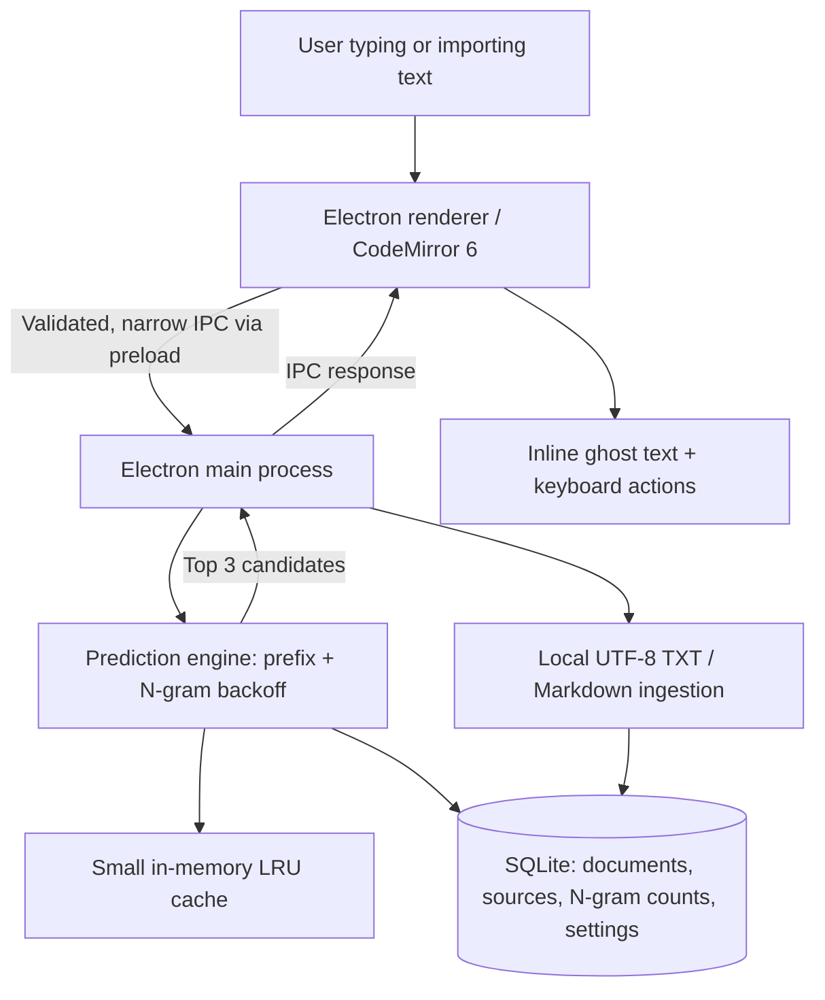
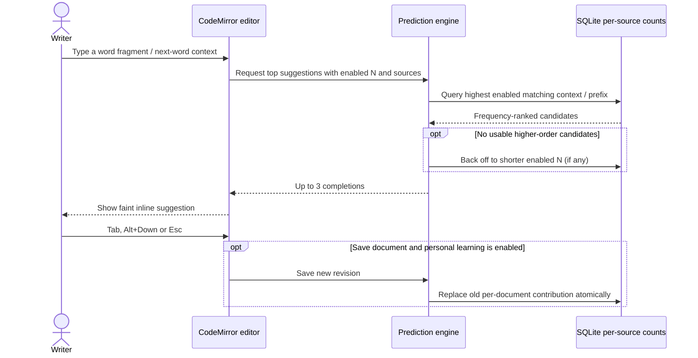

# TypeNudge

> **Write naturally. Get subtle, offline predictions as you type.**

[](LICENSE)


**TypeNudge** is an **offline desktop writing app in development** for ordinary text: notes, articles, messages and technical writing. The TND-001 foundation provides a plain-text CodeMirror editor. Later stories will suggest word completions and likely next words as subtle **ghost text** inside its own editor. Suggestions will come from a lightweight, local **unigram/bigram/trigram** model learned from text files and optionally from saved writing — **not** from an LLM or cloud API.

> **Repository status: TND-001 editor and TND-002 SQLite/import implementation; Release 0.1 is in progress.** Available: a single-window editor, normal editing shortcuts, display branding/About, and local text-source management through restricted IPC. **Editor text is session-only and is discarded when the window closes.** Imported source copies and N=1/2/3 counts persist locally. Document saving, learning and predictions remain planned in TND-003–006. See [verification](docs/releases/release-0.1-mvp/verification.md) for actual checks and platform limits.

Open **Sources → Import TXT / MD** to select UTF-8 files. The source list shows word counts and revisions; **Reindex** uses the stored copy and **Delete** removes that source's local text and counts. Reimporting the same selected file replaces changed content and leaves identical content unchanged. Limits: 10 files, 1 MiB per file, 4 MiB per selection, 50,000 words per file, 100 stored sources and 32 MiB of stored text. Source activation/settings and suggestions arrive in later stories.

## Planned Release 0.1 — Offline Predictive Writing MVP

- **Plain-text writing:** write in a CodeMirror 6 editor with unobtrusive inline (ghost-text) suggestions.
- **Keyboard controls:** **Tab** accepts; **Alt + Down** cycles suggested continuations; **Esc** dismisses. Normal editor shortcuts must keep working when no suggestion exists.
- **Three prediction sources:** **Imported Texts**, **My Writing**, or **Combined**; enable/disable individual imported files. Save-time learning from personal writing is **opt-in and off by default**.
- **Configurable N-grams:** enable any nonempty selection of **N=1, N=2 and N=3**. Prefer the longest available enabled context, then back off to shorter *enabled* contexts.
- **Word completion and next-word prediction:** prefix matching plus up to **three** ranked suggestions. Predictions update while typing; the persistent index updates only on import/reimport or an authorized save.
- **Local index:** per-source N-gram counts in a single SQLite file and a small in-memory LRU cache. Disabling a source never requires reindexing every other source.
- **Privacy:** no accounts, global keystroke capture, telemetry, network-based prediction, Ollama, OpenRouter or model downloads.

### What a user will do

1. Import one or more UTF-8 `.txt` or `.md` files (or start typing without imports).
2. Choose active source files, enable or disable learning from saved writing, and select N=1/2/3 predictors.
3. Write normally. Read a dim suggested completion at the caret and accept it with **Tab**, skip to another with **Alt + Down**, or dismiss with **Esc**.
4. Save a document locally; if personal learning is enabled, that document's previous index contribution is **replaced**, not counted twice. Revisit or disable sources whenever needed.

There is no system-wide autocomplete. Prediction operates **only within TypeNudge's own editor**.

## Architecture (planned)



The Electron renderer has **no Node.js or arbitrary filesystem access**. Only the main process owns SQLite and user-approved file operations. Local app and prediction data are stored under Electron's OS-specific `userData` directory, not in the repository.

[Architecture](docs/architecture.md) · [Security and privacy](docs/security-and-privacy.md) · [Branding](docs/branding.md).

## Prediction and learning flow (planned)



A **prefix match** completes a partially typed word; a **word N-gram** predicts a next word given up to two preceding words. This is a statistical model: suggestions depend on the chosen text corpus and may be limited in quality for small inputs or highly inflected languages.

[Storage and indexing](docs/indexing-and-storage.md) · [Prediction rules](docs/prediction-engine.md) · [Editor interactions](docs/editor-interactions.md).

## Planned technology stack

| Area | Technology |
| --- | --- |
| Desktop application | Electron |
| Language | TypeScript |
| Editor | CodeMirror 6, a small custom inline completion extension |
| Algorithms | Word-frequency, bigram, trigram, prefix matching, backoff |
| Persistence | SQLite through `better-sqlite3` in the main process |
| Optimization | SQLite B-tree indexes, bounded TypeScript LRU cache |
| Frontend build | Vite |
| Packaging | Electron Forge (platform-specific builds) |
| Unit / integration tests | Vitest |
| Desktop smoke checks | Playwright Electron support or an equivalent reproducible Electron harness |
| Delivery | GitHub Actions for focused checks; packaging on supported OS runners |

The foundation pins Electron **44.9.0**, TypeScript **7.0.2**, Vite **8.3.4**, Forge **8.0.1**, CodeMirror 6 packages, Vitest **5.0.5**, Playwright **1.64.1**, and `better-sqlite3` **13.0.3** in `package.json` and `package-lock.json`. SQLite stays external to the main JS bundle; Forge retains the native dependency and unpacks its native files from ASAR. [Forge's Vite integration](https://www.electronforge.io/config/plugins/vite) remains experimental upstream, so upgrades require desktop checks. No backend server, Docker, React or LLM integration is planned.

## Local run

Use **Node.js 24.x (24.18.0 or newer)** and npm in a desktop session. Install Linux GUI dependencies if your distribution lacks them (`libnss3`, `libnspr4`, `libasound2t64` on Ubuntu 26.04, plus GTK/GBM and their dependencies). An initial dependency/Electron download needs internet access; editor functionality does not.

```bash
npm ci
npm run dev
```

`npm start` is an alias for `npm run dev`. Vite serves only on `127.0.0.1:5173` during development; that port must be free. Keep the Chromium sandbox enabled. The built app loads local files and does not need Vite or a server.

On Windows-mounted WSL checkouts, file notifications may miss edits. Restart `npm run dev` if the window keeps serving an older module; use a fresh `package` build for verification.

```bash
npm test              # IPC/security and real SQLite integration tests
npm run typecheck
npm run package       # builds the current platform's app directory under out/
npm run test:desktop  # tests the built main/preload/renderer; run package first
```

Desktop tests require a working graphical session and use temporary user data. To run the same checks against a packaged executable, set `TYPENUDGE_EXECUTABLE` to its absolute path (see [testing](docs/testing.md)). `package` produces an application directory, not an installer. Release installers, signing, cross-platform native delivery and CI remain TND-006 work. Windows and Linux remain target platforms; verified environments are listed separately in [release verification](docs/releases/release-0.1-mvp/verification.md).

## Development roadmap

| Item | Status | Description |
| --- | --- | --- |
| [Release 0.1 — MVP](docs/releases/release-0.1-mvp/README.md) | In progress | TND-001 editor and TND-002 source index; predictions, learning and release delivery remain planned |
| [Release 0.1 verification](docs/releases/release-0.1-mvp/verification.md) | TND-001/002 evidence | Real commands, environment and limitations; subsequent stories remain Not run |
| [Future ideas](docs/future.md) | Ideas only | Optional later experiments; no committed release or acceptance criteria |

See [Roadmap](docs/roadmap.md), [Testing](docs/testing.md) and [Repository baseline](docs/repository-baseline.md). For GitHub metadata to apply **when the MVP is implemented**, see [About & Topics](docs/github-metadata.md).

Development follows [AGENTS.md](AGENTS.md) and the [story workflow](docs/story-workflow.md): one approved story at a time, relevant technology skills only, actual test evidence, and **separate approvals before implementation and git commit**. The optional worker agent is not an automatic parallel team.

## License

Apache-2.0. Copyright © 2026 **Keresztes Zsolt** — [kereszteszsolt.hu](https://kereszteszsolt.hu).

The short, two-line SPDX notice applies to **new hand-written application source**, as described in [AGENTS.md](AGENTS.md). General/generated configuration, JSON, TOML, Markdown and lockfiles **do not receive source headers**. The full legal text is in [LICENSE](LICENSE). The display-only [`brand/branding.json`](brand/branding.json) does not change legal authorship or license notices.

## Contact

**Project maintainer: Keresztes Zsolt**

| Platform | Link |
| --- | --- |
| Website | [kereszteszsolt.hu](https://kereszteszsolt.hu/) |
| GitHub | [@kereszteszsolt](https://github.com/kereszteszsolt) |

> The maintainer's website is available in Hungarian (HU), English (EN), Romanian (RO) and German (DE).

## ☕ Ways to support

**Explore ways to support the maintainer and their projects.**

[https://kereszteszsolt.hu/ways-to-support](https://kereszteszsolt.hu/ways-to-support)

<p align="center">
  <a href="https://buymeacoffee.com/kereszteszsolt"></a><br>
  <strong>Every coffee counts! ☕❤️</strong>
</p>

---

<p align="center">
  <strong>Made with ❤️ by <a href="https://kereszteszsolt.hu/">Keresztes Zsolt</a></strong><br>
  ⭐ Star this repository if you find it useful!
</p>
