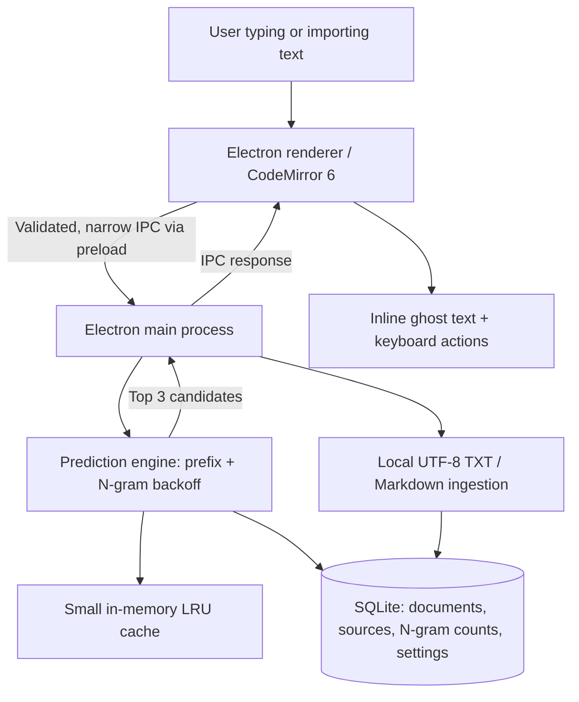
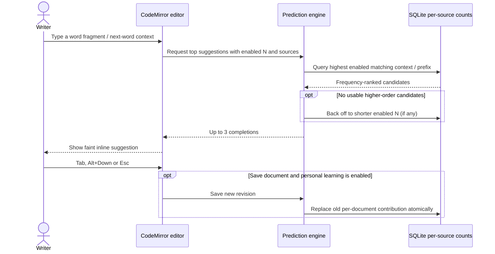

# TypeNudge

> **Write naturally. Get subtle, offline predictions as you type.**

[](LICENSE)


**TypeNudge** is an **offline desktop writing app in development** for ordinary text: notes, articles, messages and technical writing. Its plain-text CodeMirror editor suggests word completions and likely next words as subtle **ghost text**. Suggestions come from a lightweight, local **unigram/bigram/trigram** model indexed from imported text files and, with explicit consent, saved personal documents. No LLM or cloud API is used.

> **Repository status: TND-001–006 implemented; Release 0.1 verified locally on Linux x64/WSLg and Windows x64.** Available: the desktop editor, local text-source management, inline N=1/2/3 suggestions, persisted preferences and personal documents with opt-in save-time learning. **Use Save (Ctrl/Cmd+S) to persist text locally; unsaved changes stay in memory and have a discard guard.** CI checks are configured; hosted execution and other-platform delivery remain unverified. See [verification](docs/releases/release-0.1-mvp/verification.md) for actual checks and platform limits.

Open **Sources → Import TXT / MD** to select UTF-8 files. The source list shows word counts and revisions; **Use** enables a source for predictions, **Reindex** uses the stored copy and **Delete** removes that source's local text and counts. Reimporting the same selected file replaces changed content and leaves identical content unchanged. Limits: 10 files, 1 MiB per file, 4 MiB per selection, 50,000 words per file, 100 stored sources and 32 MiB of stored text.

Choose **Imported Texts**, **My Writing** or **Combined** above the editor and any nonempty set of N=1/2/3. **Tab** accepts the missing suffix, **Alt+Down** cycles up to three candidates, and **Esc** dismisses. Without a suggestion, Tab moves focus normally. **My Writing** uses enabled learned documents while personal learning is on; **Combined** also includes active imports. Settings and source activation persist across restarts.

Use **New**, give the document a name, then **Save**. **Documents** reopens/deletes saved notes and provides **Learn from my writing**, off by default. Enabling learning affects future explicit saves; it never indexes existing notes automatically. Saving while on replaces that note's counts, while saving with learning off removes its previous learned contribution. Turning learning off pauses personal predictions while retaining other learned counts. **Use**, **Remove learning** and **Reset personal learned data** control personal contributions independently; reset also turns learning off and keeps saved documents and imports. Storage is limited to 1 MiB per text, 100 combined sources/documents and 32 MiB total UTF-8 text.

## Release 0.1 — Offline Predictive Writing MVP

- **Plain-text writing:** write in a CodeMirror 6 editor with unobtrusive inline (ghost-text) suggestions.
- **Keyboard controls:** **Tab** accepts; **Alt + Down** cycles suggested continuations; **Esc** dismisses. Normal editor shortcuts must keep working when no suggestion exists.
- **Three prediction sources:** **Imported Texts**, **My Writing**, or **Combined**; enable/disable individual imported files. Save-time learning from personal writing is **opt-in and off by default**.
- **Configurable N-grams:** enable any nonempty selection of **N=1, N=2 and N=3**. Prefer the longest available enabled context, then back off to shorter *enabled* contexts.
- **Word completion and next-word prediction:** prefix matching plus up to **three** ranked suggestions. Predictions update while typing; the persistent index updates only on import/reimport or an authorized save.
- **Local index:** per-source N-gram counts in a single SQLite file and a small in-memory LRU cache. Disabling a source never requires reindexing every other source.
- **Privacy:** no accounts, global keystroke capture, telemetry, network-based prediction, Ollama, OpenRouter or model downloads.

### Writing with TypeNudge

1. Import one or more UTF-8 `.txt` or `.md` files (or start typing without imports).
2. Choose active source files, enable or disable learning from saved writing, and select N=1/2/3 predictors.
3. Write normally. Read a dim suggested completion at the caret and accept it with **Tab**, skip to another with **Alt + Down**, or dismiss with **Esc**.
4. Save a document locally; if personal learning is enabled, that document's previous index contribution is **replaced**, not counted twice. Revisit or disable sources whenever needed.

There is no system-wide autocomplete. Prediction operates **only within TypeNudge's own editor**.

## Architecture



The Electron renderer has **no Node.js or arbitrary filesystem access**. Only the main process owns SQLite and user-approved file operations. Local app and prediction data are stored under Electron's OS-specific `userData` directory, not in the repository.

[Architecture](docs/architecture.md) · [Security and privacy](docs/security-and-privacy.md) · [Branding](docs/branding.md).

## Prediction and learning flow



A **prefix match** completes a partially typed word; a **word N-gram** predicts a next word given up to two preceding words. This is a statistical model: suggestions depend on the chosen text corpus and may be limited in quality for small inputs or highly inflected languages.

[Storage and indexing](docs/indexing-and-storage.md) · [Prediction rules](docs/prediction-engine.md) · [Editor interactions](docs/editor-interactions.md).

## Technology stack

| Area | Technology |
| --- | --- |
| Desktop application | Electron |
| Language | TypeScript |
| Editor | CodeMirror 6, a small custom inline completion extension |
| Algorithms | Word-frequency, bigram, trigram, prefix matching, backoff |
| Persistence | SQLite through `better-sqlite3` in the main process |
| Optimization | SQLite B-tree indexes, bounded TypeScript LRU cache |
| Frontend build | Vite |
| Packaging | Electron Forge (platform-specific builds) |
| Unit / integration tests | Vitest |
| Desktop smoke checks | Playwright Electron support or an equivalent reproducible Electron harness |
| Delivery checks | GitHub Actions for typecheck and unit/SQLite tests; local desktop packaging checks |

The foundation pins Electron **44.9.0**, TypeScript **7.0.2**, Vite **8.3.4**, Forge **8.0.1**, CodeMirror 6 packages, Vitest **5.0.5**, Playwright **1.64.1**, and `better-sqlite3` **13.0.3** in `package.json` and `package-lock.json`. SQLite stays external to the main JS bundle; Forge retains the native dependency and unpacks its native files from ASAR. [Forge's Vite integration](https://www.electronforge.io/config/plugins/vite) remains experimental upstream, so upgrades require desktop checks. No backend server, Docker, React or LLM integration is planned.

## Local run

Use **Node.js 24.x (24.18.0 or newer)** and npm in a desktop session. Install Linux GUI dependencies if your distribution lacks them (`libnss3`, `libnspr4`, `libasound2t64` on Ubuntu 26.04, plus GTK/GBM and their dependencies). An initial dependency/Electron download needs internet access; editor functionality does not.

```bash
npm ci
npm run dev
```

`npm start` is an alias for `npm run dev`. Vite serves only on `127.0.0.1:5173` during development; that port must be free. Keep the Chromium sandbox enabled. The built app loads local files and does not need Vite or a server.

On Windows-mounted WSL checkouts, file notifications may miss edits. Restart `npm run dev` if the window keeps serving an older module; use a fresh `package` build for verification.

For native Windows, use Windows Node.js 24.x (24.18.0 or newer) and npm 11.16.0 or newer in PowerShell:

```powershell
cd C:\P\ghpub\www-temp\type-nudge # adjust to your checkout
npm.cmd ci
npm.cmd run dev
```

Stop development before packaging with `npm.cmd run package`. On Windows x64, the expected executable is `out\TypeNudge-win32-x64\type-nudge.exe`; keep its complete application directory together. `npm.cmd ci` replaces the installed dependencies for the current OS: do not share an active `node_modules` installation between WSL and Windows, and reinstall when switching.

The pinned `better-sqlite3` 13 uses shipped Node-API binaries. `package.json` denies its unnecessary install-time build through npm's `allowScripts` policy, and Forge skips rebuilding only that module through `rebuildConfig.ignoreModules`. Its prebuilds still need to be unpacked from ASAR and checked in the real packaged app. This avoids an unnecessary Windows `node-gyp`/Visual C++ build; other native modules retain Forge's normal rebuild behavior. Revisit both settings when changing the SQLite dependency or targeting a platform without a shipped compatible prebuild.

```bash
npm test              # IPC/security and real SQLite integration tests
npm run typecheck
npm run benchmark:prediction # reproducible synthetic SQLite prediction benchmark
npm run package       # builds the current platform's app directory under out/
npm run test:desktop  # tests the built main/preload/renderer; run package first
```

Desktop tests require a working graphical session and use temporary user data. Verified packaged targets are **Linux x64 under WSLg / Ubuntu 26.04** and **native Windows x64 (build 26100)**. After `npm run package`, launch its application directory or run the same tests against its actual executable:

```bash
./out/TypeNudge-linux-x64/type-nudge
TYPENUDGE_EXECUTABLE="$PWD/out/TypeNudge-linux-x64/type-nudge" npm run test:desktop
```

For Windows PowerShell:

```powershell
npm.cmd run package
$env:TYPENUDGE_EXECUTABLE = "$PWD\out\TypeNudge-win32-x64\type-nudge.exe"
npm.cmd run test:desktop
Remove-Item Env:TYPENUDGE_EXECUTABLE
```

`package` creates an **unsigned application directory**, with native SQLite unpacked from ASAR and Apache/bundled dependency notices included. No installer, signing or publication is configured. macOS, Linux outside WSLg and other architectures remain **Not run**. See [verification](docs/releases/release-0.1-mvp/verification.md) for commands, GUI-library preparation and the platform evidence. Do not package concurrently with `dev`, which rewrites the same `.vite/` build directory.

The [Checks workflow](.github/workflows/checks.yml) uses Node 24.18.0 on Ubuntu 24.04 to install the lockfile, typecheck and run unit/real SQLite tests. It skips the Electron binary download and does not run GUI, package or publish jobs. Actions are pinned to upstream commit IDs with read-only repository permissions. Its commands passed locally in a fresh temporary installation; **hosted GitHub Actions execution is Not run**. No separate lint configuration is present.

`npm run benchmark:prediction` reports first indexing, retained-copy reindexing and LRU-cleared/warm prediction timings for two synthetic sources at 600 and 30,000 total tokens. Measurements include corpus sizes, CPU/runtime/SQLite versions and deterministic result checks. They exclude Electron IPC, rendering, file-picker/decoding and database-open time; they are local observations with a bounded vocabulary, not worst-case or end-to-end typing guarantees. Results are recorded in [verification](docs/releases/release-0.1-mvp/verification.md#tnd-006--2026-10-18).

## Development roadmap

| Item | Status | Description |
| --- | --- | --- |
| [Release 0.1 — MVP](docs/releases/release-0.1-mvp/README.md) | Implemented; locally verified | All six stories; Linux x64/WSLg and Windows x64 package checks, Linux development checks, CI configuration and measured performance |
| [Release 0.1 verification](docs/releases/release-0.1-mvp/verification.md) | TND-001–006 evidence | Real commands, hardware, timings and platform/CI limits |
| [Future ideas](docs/future.md) | Ideas only | Optional later experiments; no committed release or acceptance criteria |

See [Roadmap](docs/roadmap.md), [Testing](docs/testing.md) and [Repository baseline](docs/repository-baseline.md). For suggested GitHub metadata, see [About & Topics](docs/github-metadata.md).

Development follows [AGENTS.md](AGENTS.md) and the [story workflow](docs/story-workflow.md): one approved story at a time, relevant technology skills only, actual test evidence, and **separate approvals before implementation and git commit**. The optional worker agent is not an automatic parallel team.

## License

Apache-2.0. Copyright © 2026 **Keresztes Zsolt** — [kereszteszsolt.hu](https://kereszteszsolt.hu).

The short, two-line SPDX notice applies to **new hand-written application source**, as described in [AGENTS.md](AGENTS.md). General/generated configuration, JSON, TOML, Markdown and lockfiles **do not receive source headers**. The full legal text is in [LICENSE](LICENSE). The display-only [`brand/branding.json`](brand/branding.json) does not change legal authorship or license notices.

## Contact

**Project maintainer: Keresztes Zsolt**

| Platform | Link |
| --- | --- |
| Website | [kereszteszsolt.hu](https://kereszteszsolt.hu/) |
| GitHub | [@kereszteszsolt](https://github.com/kereszteszsolt) |

> The maintainer's website is available in Hungarian (HU), English (EN), Romanian (RO) and German (DE).

## ☕ Ways to support

**Explore ways to support the maintainer and their projects.**

[https://kereszteszsolt.hu/ways-to-support](https://kereszteszsolt.hu/ways-to-support)

<p align="center">
  <a href="https://buymeacoffee.com/kereszteszsolt"></a><br>
  <strong>Every coffee counts! ☕❤️</strong>
</p>

---

<p align="center">
  <strong>Made with ❤️ by <a href="https://kereszteszsolt.hu/">Keresztes Zsolt</a></strong><br>
  ⭐ Star this repository if you find it useful!
</p>
