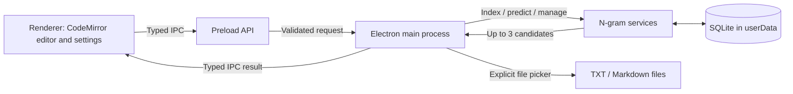

# Architecture — Release 0.1

**Implemented in TND-001:** Electron main/preload/renderer separation, one plain-text CodeMirror window, display branding, and two IPC operations: `app:info` (no arguments) and `app:open-link` (one allowlisted branding link ID). IPC validates the window, main frame, exact entry URL, argument count and type. No text or filesystem operation crosses this bridge yet. The rest of this architecture describes later planned stories.

TypeNudge will be **one Electron desktop app**, not a browser-hosted web application. The **renderer** hosts CodeMirror 6, ghost-text decorations and settings. A **small preload bridge** exposes narrowly scoped IPC operations. The **main process** owns local imports, document persistence and SQLite queries, calling a pure prediction module where possible.

## Responsibilities

- **UI renderer:** document editing, source/N choices, currently visible suggestions, accessibility, and explicit save/import actions. No direct SQLite/file system/Node APIs.
- **Preload:** the minimum message bridge. It is not an unrestricted shell, SQL client, or filesystem adapter.
- **Main services:** validated IPC dispatch, local file reading/writing, SQLite lifetime, transaction handling and bounded prediction requests.
- **Indexer:** Unicode-aware tokenization and immutable document revision inputs; per-source N-gram counts with atomic reindexing.
- **Prediction engine:** consumes active sources, allowed N, context and partial prefix; queries indexed results and returns ranked candidates.
- **SQLite:** local persistent store under Electron `userData`; not in the repository, user-selected import directory, installation directory, or generated build output.

## Data boundaries

The application **never reads other applications' typing**, monitors global hotkeys or sends source text to a model endpoint. External author/project/support links are optional and require an explicit click, opening in the user's default browser. The application itself does not need any network connection for predictions.

Model the UI as a single window; no multi-user account, server sync or cloud features. See [Privacy and security](security-and-privacy.md).

## Build and platform notes

Electron, CodeMirror 6, Vite and Electron Forge are pinned by `TND-001`. The sandboxed preload is bundled into a single CommonJS file. Production renderer requests are restricted to its bundled directory; development permits only the selected loopback Vite/HMR port. Navigation, popups, webviews, downloads and permissions are denied. The renderer CSP uses a nonce for CodeMirror/Vite style elements, with no inline script or eval permission.

`better-sqlite3` is not installed yet. It is a native module requiring the Electron ABI to match the packaged runtime. `TND-006` proves actual supported release packages and records unverified platforms as `Not run`.
